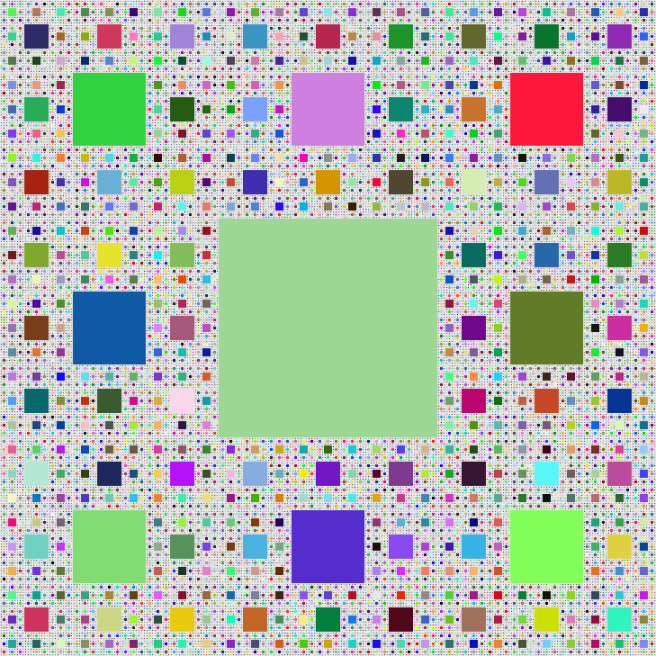

# Hi, I'm Thomas Wening

Physicist (M.Sc.) turned software developer, based in Hamburg. I build software
where being right matters more than being quick: laboratory software at work,
tools for physicists and DJs in my own time.

## What I'm building

*Last updated: November 2026*

### Tools for DJs

- **[ZipDJ fixes](https://github.com/thomaswening/zipdj-fixes)**: a userscript
  that makes the ZipDJ record pool easier to dig through: sortable columns, up
  to 500 tracks a page, downloaded tracks dimmed or hidden, real links to
  releases and labels. *Works today:
  [install from Greasy Fork](https://greasyfork.org/scripts/606173-zipdj-fixes).*
- **[CrateEdit](https://github.com/thomaswening/CrateEdit)**: a tag editor for
  DJ music collections that never touches your cue points. Edits are staged,
  verified and crash-safe. Files it edits are checked in Rekordbox, Serato and
  Traktor. C# / .NET 10, Windows and macOS. *The tag engine is done. The
  application UI comes next.*
- **[abendkasse](https://github.com/thomaswening/abendkasse)**: invoices for
  DJs after the gig. Type in what changed, get the PDF, send it. A free web app
  that keeps your data on your device. *Requirements stage.*

### Tools for physicists

- **[Tante](https://github.com/thomaswening/Tante)**: a symbolic mathematics
  engine for physicists, meant as a modern, well-documented successor to
  [FORM](https://github.com/form-dev/form). C++. *Foundations: build and CI on
  Windows, macOS and Linux. Nothing calculates yet.*
- **PartonForge** *(private for now)*: a clean-room C++20 reimplementation of
  the Parton Branching Monte Carlo for TMD parton densities. Its output files
  already round-trip byte for byte against the reference Fortran code.

### And one for myself

- **[Skip the Fluff](https://github.com/thomaswening/skip-the-fluff)**: an
  unofficial, distraction-free Android wrapper for duolingo.com that leaves out
  the nags, popups and animations, never the exercises. Kotlin. *In design.*

## How I work

The same habits run through all of these projects:

- **Requirements first.** Each project starts with numbered, testable
  requirements and records its design choices as decision records.
- **Checked against reality.** Physics code is validated against reference
  implementations and published numbers, file handling against the real
  applications that read the files.
- **Refuse rather than guess.** When the input is not fully understood, the
  software stops and says why instead of producing something plausible.
- **Documented for the next reader**, including the scripts and CI workflows.

## What I learn

**[doubting-thomas](https://thomaswening.github.io/doubting-thomas/)** is my
public knowledge base: one note per concept, from C# and build systems to
numerics and physics. Each note states its key claims so that any AI can quiz
me on them.

## At work

Professionally I develop Windows desktop software in C# / .NET (WPF) for
laboratory environments: instrument control, experimental data and the
analysis that runs on it.

## Earlier projects

Two smaller projects from my time learning .NET:
[PhaseShift](https://github.com/thomaswening/PhaseShift), a WPF focus timer
with Pomodoro and custom modes, and
[Salter](https://github.com/thomaswening/salter), user management with
encrypted storage on the console.

## Contact

📧 [thomaswening94@gmail.com](mailto:thomaswening94@gmail.com) ·
[LinkedIn](https://www.linkedin.com/in/thomas-wening-a96aa51b8/), where I also
write about .NET and software development.

*(Yes, that's a [Sierpinski carpet](https://en.wikipedia.org/wiki/Sierpi%C5%84ski_carpet).
Sometimes I just like to play.)*
